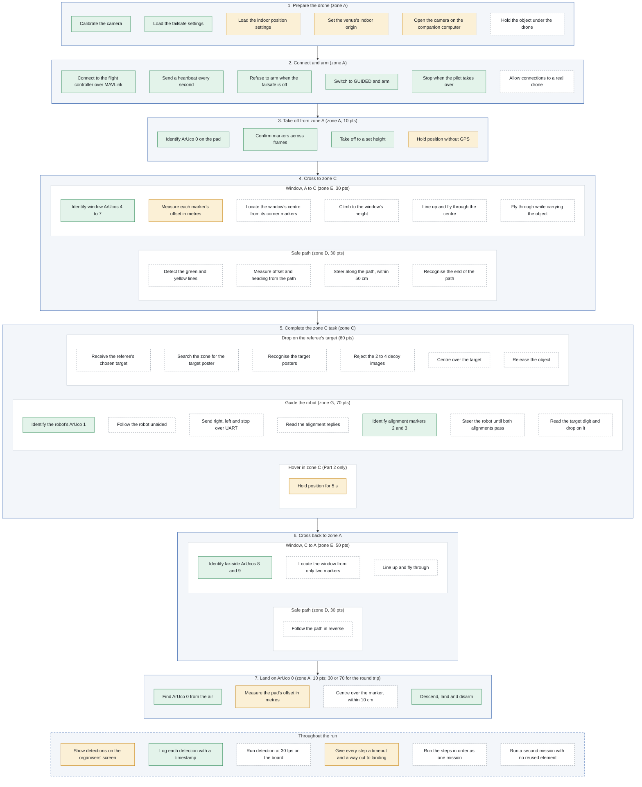
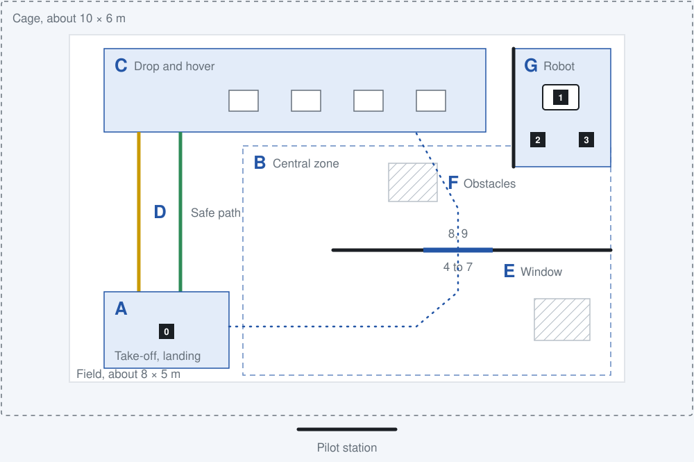

# Mission Map

The goals of one full automatic mission, in order, with the functions each goal needs and how far the code has got. Points are automatic-flight values from the V0 rules in [`contest-rules.md`](contest-rules.md). Update a function's status when its code changes.

**Status:** 17 built, 9 partial and 28 not started, out of 54 functions. Built means it works on a PC or in the ArduPilot simulator. Nothing has been tested on the drone yet.

## Flowchart

Steps run top to bottom. Where a step holds more than one route, choose one. Green boxes are built, amber boxes are partial and dashed boxes are not started.

A full automatic mission (take-off to landing in zone A, one drop task and one crossing) is worth 100 points, twice. The second may not reuse any element, so it needs the robot task and the window.

## Arena

This is a sketch from the V0 zone descriptions. The rules give no map, so the zone positions are a guess. The cage and field sizes are to scale.

| Zone | Content | Steps |
|------|---------|-------|
| A | Take-off and landing, with ArUco 0 | 1 to 3, 7 |
| B | Central zone, the only one with obstacles and objects over 50 cm | |
| C | Drop and hover zone, with four A3 target posters | 5 |
| D | Safe path: yellow line on the left and green on the right, seen from the pilot station, with no obstacle within 50 cm | 4, 6 |
| E | Window, 100 × 100 cm at a random height, with ArUcos 4 to 7 on the near side and 8 and 9 on the far side | 4, 6 |
| F | Obstacles | |
| G | Robot zone, with ArUcos 2 and 3 behind a visual barrier | 5 |

## Functions by Step

### 1. Prepare the drone

In the 10 minutes before the run. Zone A.

| Function | Status | Module | Code | Note |
|----------|--------|--------|------|------|
| Calibrate the camera | Built | vision | `calibrate.py` | Needs a run with the chosen camera |
| Load the failsafe settings | Built | flight | `failsafe.parm` | Lands after 3 s without a heartbeat |
| Load the indoor position settings | Partial | flight | `stabilisation/indoor.parm` | PMW3901 and rangefinder drivers not set |
| Set the venue's indoor origin | Partial | flight | `vehicle.ORIGIN` | Still the simulator's home position |
| Open the camera on the companion computer | Partial | vision | `camera_rubikpi_csi.py` | Not run on the board; camera not chosen |
| Hold the object under the drone | Not started | payload |  | Ø40 mm ferrous disc, 50 g |

### 2. Connect and arm

Hand control to the program safely. Zone A.

| Function | Status | Module | Code | Note |
|----------|--------|--------|------|------|
| Connect to the flight controller over MAVLink | Built | flight | `Vehicle.connect()` |  |
| Send a heartbeat every second | Built | flight | `Vehicle._heartbeat()` |  |
| Refuse to arm when the failsafe is off | Built | flight | `Vehicle.arm()` |  |
| Switch to GUIDED and arm | Built | flight | `set_mode(), arm()` |  |
| Stop when the pilot takes over | Built | flight | `PilotTakeover` |  |
| Allow connections to a real drone | Not started | flight | `is_simulator()` | Blocked on purpose; needs a team decision |

### 3. Take off from zone A

Zone A. 10 pts.

| Function | Status | Module | Code | Note |
|----------|--------|--------|------|------|
| Identify ArUco 0 on the pad | Built | vision | `detect.make_detector()` |  |
| Confirm markers across frames | Built | vision | `MarkerTracker.update()` |  |
| Take off to a set height | Built | flight | `Vehicle.takeoff()` |  |
| Hold position without GPS | Partial | flight | `indoor.parm` | Simulator only; target within 0.5 m for 2 min |

### 4. Cross to zone C

Choose one route.

**Window, A to C (zone E, 30 pts)**

| Function | Status | Module | Code | Note |
|----------|--------|--------|------|------|
| Identify window ArUcos 4 to 7 | Built | vision | `ARUCO_LABELS` |  |
| Measure each marker's offset in metres | Partial | vision | `pose.marker_offset()` | Not used by the detection loop yet |
| Locate the window's centre from its corner markers | Not started | vision |  | Exact marker positions not published |
| Climb to the window's height | Not started | navigation |  | Height is random |
| Line up and fly through the centre | Not started | navigation |  |  |
| Fly through while carrying the object | Not started | navigation |  | +10 pts |

**Safe path (zone D, 30 pts)**

| Function | Status | Module | Code | Note |
|----------|--------|--------|------|------|
| Detect the green and yellow lines | Not started | vision |  | Needs a colour camera |
| Measure offset and heading from the path | Not started | vision |  |  |
| Steer along the path, within 50 cm | Not started | navigation |  |  |
| Recognise the end of the path | Not started | navigation |  |  |

### 5. Complete the zone C task

Choose one task. Zone C.

**Drop on the referee's target (60 pts)**

| Function | Status | Module | Code | Note |
|----------|--------|--------|------|------|
| Receive the referee's chosen target | Not started | mission |  | Open question; manual input makes it manual |
| Search the zone for the target poster | Not started | navigation |  | Four A3 posters |
| Recognise the target posters | Not started | vision |  | Images not published |
| Reject the 2 to 4 decoy images | Not started | vision |  | Revealed at the final |
| Centre over the target | Not started | navigation |  |  |
| Release the object | Not started | payload |  | First ground contact must be on the target |

**Guide the robot (zone G, 70 pts)**

| Function | Status | Module | Code | Note |
|----------|--------|--------|------|------|
| Identify the robot's ArUco 1 | Built | vision | `ARUCO_LABELS` |  |
| Follow the robot unaided | Not started | navigation |  |  |
| Send right, left and stop over UART | Not started | comms |  | D, G, A at 57600 baud |
| Read the alignment replies | Not started | comms |  | N, F, S |
| Identify alignment markers 2 and 3 | Built | vision | `ARUCO_LABELS` |  |
| Steer the robot until both alignments pass | Not started | mission |  |  |
| Read the target digit and drop on it | Not started | comms |  |  |

**Hover in zone C (Part 2 only)**

| Function | Status | Module | Code | Note |
|----------|--------|--------|------|------|
| Hold position for 5 s | Partial | flight | `indoor.parm` | Simulator only |

### 6. Cross back to zone A

Same route type as the way out.

**Window, C to A (zone E, 50 pts)**

| Function | Status | Module | Code | Note |
|----------|--------|--------|------|------|
| Identify far-side ArUcos 8 and 9 | Built | vision | `ARUCO_LABELS` |  |
| Locate the window from only two markers | Not started | vision |  | They are off-centre |
| Line up and fly through | Not started | navigation |  |  |

**Safe path (zone D, 30 pts)**

| Function | Status | Module | Code | Note |
|----------|--------|--------|------|------|
| Follow the path in reverse | Not started | navigation |  |  |

### 7. Land on ArUco 0

Zone A. 10 pts; 30 or 70 for the round trip.

| Function | Status | Module | Code | Note |
|----------|--------|--------|------|------|
| Find ArUco 0 from the air | Built | vision | `detect.py` |  |
| Measure the pad's offset in metres | Partial | vision | `pose.marker_offset()` |  |
| Centre over the marker, within 10 cm | Not started | navigation |  |  |
| Descend, land and disarm | Built | flight | `Vehicle.land()` |  |

### Throughout the run

Needed at every step.

| Function | Status | Module | Code | Note |
|----------|--------|--------|------|------|
| Show detections on the organisers' screen | Partial | mission | `--show` | Local window only |
| Log each detection with a timestamp | Built | vision | `detections.csv` |  |
| Run detection at 30 fps on the board | Not started | vision |  | Not measured |
| Give every step a timeout and a way out to landing | Partial | mission | `Vehicle._wait()` | Flight steps only |
| Run the steps in order as one mission | Not started | mission |  |  |
| Run a second mission with no reused element | Not started | mission |  | 100 pts each |

## Open Questions

These V0 gaps block some functions above. The full list is in [`contest-rules.md`](contest-rules.md).

- What are the target images? Annex 3 is not published.
- Where exactly are the window markers?
- How does the drone receive the referee's target without a manual command?
- Where is each zone? An official field plan would replace the sketch above.
